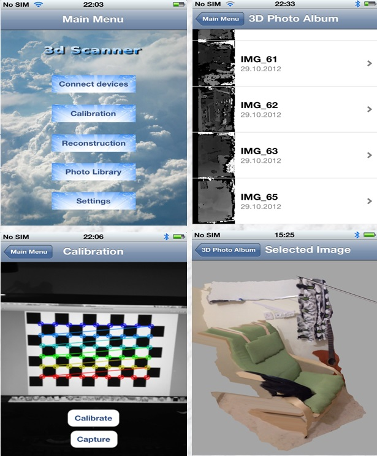

# 3D Stereo Reconstruction using iPhones

<p align="center"></p>

*Original project image, unchanged.*

This two-phone iOS project implemented stereo calibration, rectification and disparity calculation, computed point clouds manually from a Q matrix, and coordinated the phones over GameKit.

Students: Ron Slossberg, Omer Shaked. Supervision: Aaron Wetzler.


## Original

The original source is pinned at `69a76767b2ce74f7b580ddb7b81a43fbb1dd346b`; clone with `--recurse-submodules` to inspect it. A current build is blocked by missing resources and legacy dependencies, and no device or depth-accuracy result is recorded. The [recovery notes](docs/RECOVERY.md) record historical requirements and attribution; see also [source provenance](source/PROVENANCE.json).

## Updated

[**Run the browser demo**](https://twerdster.github.io/iphone-stereo-reconstruction/)

A separate browser demo, written in November 2026, generates a rectified image pair. Click a textured patch in the left image, run a horizontal block match, then change the baseline or focal length to see depth computed as Z = f × B / d. The right image is an exact shift of the left, so the match is clean by construction. This is new JavaScript, not a port of the OpenCV/iOS code, and it does not validate the original Q-matrix or disparity scaling. The recovered original files are unchanged.

### Run locally

```sh
python3 -m http.server 8000 --directory docs
```

Then open http://localhost:8000. No build step or external service is required.

### Checks and licensing

Browser-check results, implementation notes and limits are in [updated/README.md](updated/README.md). These checks apply only to the new demo; they do not validate the historical application or any device. The [MIT license](docs/DEMO-LICENSE.txt) covers only the new demo; original materials keep their existing attribution and terms.
